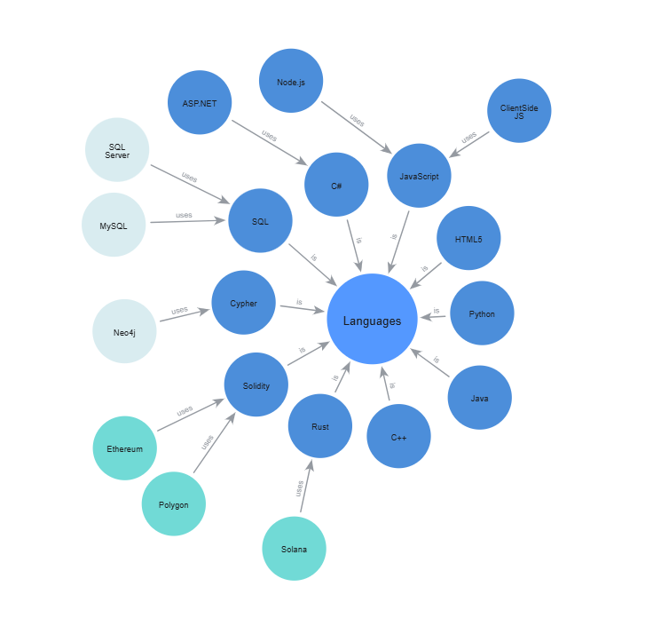

## About
Senior Full-Stack Engineer / Data and Database Engineer with 15+ years of experience designing, deploying and maintaining web applications, database architectures and server infrastructure.

Highly Experienced with SQL (SQL Server, MySQL), Data Analysis (design and queries) Node.js (including Express and EJS), JSON, HTML5, CSS, Javascript.
Experienced with n8n, RESTFUL APIs, Solidity, Forge, Anvil, ethers.js, Basic Tensor Flow, Basic ML.

## Currently Working with / Activity:
 - n8n workFlows and chat experiences interfacing and returning server based data to users depending on keywords in chat, using internal server data APIs to get data and formatting back into chat responses
 - Node.js Data RESTFUL data API's for external systems (like a Chat workflow, or data report) to query internal server data
 - Using OpenSSL for investigation into complex SSL certificate chain tracing and verification to diagnose certificate issues for websites with SSL issues
 - Smart Contract Development, DeSci Data Applications Research with Smart Contracts
 - Research and Testing with ERC-20 / ERC-721 and their Applications
 - Forge / Forge Tests simulating user interaction with Smart Contracts
 - Neo4J Graphing, and Graph databases (Cypher Language, AuraDB)
 - Linux VPS Hosting and Server Management 
 - Node.js Applications (Express / EJS) with MySQL Databases
 - HTML / CSS Designs and Updates 
 
## In the future, looking to collaberate and work on projects relating to:
 
 - HTML / CSS Website Development
 - Data Processing Tools
 - n8n Workflows / Automation scripts to save Organizations time
 - Building API's to return Organization / Project data for other systems to use
 - Server Monitoring Tools that can detect changes or internal issues that can affect users
 - Chat Experiences that know about internal organization data using that can query organization data APIs
 - Node Graph Databases and Real World Object and System Relationship Mapping with optional Visualizations (Neo4j & Cypher)
 - Queries of Complex Relationships in Node Based Data (Neo4j via Cypher queries) to better understand Systems and Relationships between entities
 - Education or Educational tools
 - The Environment and Pollution Detection or Mitigation
 - Machine Learning Applications
 - Space based Remote Sensing Data Analysis
 - Projects raising awareness about:
   - The Environment
   - Pollution, especially oil spills, ocean plastic, other serious pollution
   - Space and Space Exploration
   - Disasters affecting people
   - Animal Welfare 
   
    
## Recent Work with Graph Databases

Here is a visualization I made using Neo4j, showing how languages are used in coding, databases and blockchains.

Visualization by RLJLW, using Neo4J, with AuraDB

The above is represents a Neo4j database of nodes and relationships that can be queried using the query language, Cypher.

<!--
**RLJLW/rljlw** is a ✨ _special_ ✨ repository because its `README.md` (this file) appears on your GitHub profile.

Here are some ideas to get you started:

- 🔭 I’m currently working on ...
- 🌱 I’m currently learning ...
- 👯 I’m looking to collaborate on ...
- 🤔 I’m looking for help with ...
- 💬 Ask me about ...
- 📫 How to reach me: ...
- 😄 Pronouns: ...
- ⚡ Fun fact: ...

-->
